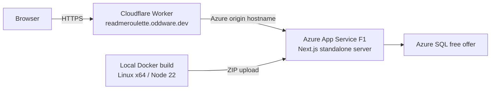

# Deploy README Roulette

Use **`npm run deploy`** for a full update. The application runs on Azure; Cloudflare provides the public hostname and proxies traffic. This is not a Cloudflare Pages deployment, and no container image is pushed to a registry.



| Component | Target |
| --- | --- |
| Public website | https://readmeroulette.oddware.dev |
| Azure origin | https://readme-roulette-daac2bd8.azurewebsites.net |
| Azure resource group | `rg-readme-roulette-daac2bd8` |
| Azure app / free plan | `readme-roulette-daac2bd8` / `readme-roulette-daac2bd8-free` |
| SQL server / database | `readme-roulette-daac2bd8-sql` / `roulette` |
| Cloudflare Worker | `readme-roulette-proxy` |

Azure F1 [does not support custom-domain bindings](https://learn.microsoft.com/en-us/azure/app-service/app-service-web-tutorial-custom-domain). The Worker forwards requests using the Azure hostname; Cloudflare owns the public DNS record and TLS certificate. An ordinary CNAME directly to Azure does not replace this proxy.

## Commands

Run from the repository root:

| Command | What it does |
| --- | --- |
| `npm run deploy` | Check prerequisites/authentication and free tiers, test, build/upload Azure, publish the Worker, verify the public domain, set `APP_URL`, verify browser-origin requests. |
| `npm run deploy -- --dry-run` | Print the full plan; no commands, network requests, builds, or cloud changes. |
| `npm run deploy -- --app-only` | Update Azure application code and supplied settings; preserve the current public URL. No Cloudflare login needed. |
| `npm run deploy -- --proxy-only` | Publish the Worker, verify routing, and configure the public URL; skip the Azure build. |
| `npm run deploy:configure` | Apply nonempty GitHub/AI values from local environment files and set the public URL. No code upload or Worker publication. |
| `npm run deploy:status` | Inspect live tiers, `APP_URL`, both APIs and the public browser-origin check. Exit nonzero on a mismatch. No settings change. |
| `npm run deploy:login` | Open Cloudflare sign-in using the pinned Wrangler CLI and a Node 22 runner. |
| `npm run deploy:setup` | First installation only: create free Azure resources, then deploy both services. Refuses an existing resource group. |

`setup` is **not** the routine update command. The existing installation already has its Azure resources. `--app-only` and `--proxy-only` are mutually exclusive and apply only to `deploy`.

## Local prerequisites and first use on a machine

- Node.js 22 and npm (`.nvmrc` selects 22; `nvm use` if you use nvm).
- Python 3.10 or newer.
- Azure CLI signed in to the subscription that owns this deployment.
- Docker running with Linux x64 build support. Docker Desktop on Apple Silicon is supported.
- Access to Cloudflare's `oddware.dev` zone for full/proxy deployments.
- The private `.azure/readme-roulette-daac2bd8.json` state file for this existing installation, restored securely from backup when using another machine.

```sh
npm ci
az login
npm run deploy:login
npm run deploy -- --dry-run
npm run deploy
```

Wrangler is pinned to `4.143.0` by the script and runs through `npx` with Node 22. Its first invocation may download those tools. If Cloudflare has multiple accounts, set `CLOUDFLARE_ACCOUNT_ID` to the account owning `oddware.dev`; CI can supply a scoped `CLOUDFLARE_API_TOKEN` through its secret store. Never put account tokens in committed configuration.

For a genuinely new installation, run `npm run deploy:setup` instead of `npm run deploy`. The checked-in targets describe this project; deploying a separate copy also requires updating the Azure defaults in `scripts/azure_deploy.py` and the Worker name/domain/origin in `deploy/cloudflare/wrangler.jsonc`. Keep that JSONC file valid JSON because both tools read it. Resource names must be globally available.

## What happens during a full update

1. The script checks the selected Azure subscription, deployment state, Docker, Cloudflare authentication, origin hostname, and free-tier settings before making changes.
2. Application tests, deployment-script tests, and TypeScript checks run.
3. Docker builds the Next.js standalone output and native dependencies for Linux x64 / Node 22. Build failure prevents code upload and settings changes for an existing installation.
4. The Azure helper packages `.deploy/app.zip`, applies changed settings, and uploads the ZIP through [App Service deployment](https://learn.microsoft.com/en-us/azure/app-service/deploy-zip). Azure starts `node server.js`; the build runs locally, not on F1.
5. Wrangler publishes the Worker and its [Custom Domain](https://developers.cloudflare.com/workers/configuration/routing/custom-domains/). It never follows GitHub redirects on behalf of the browser or caches personalized API responses.
6. The script waits for the public session API to respond before setting Azure's `APP_URL` to `https://readmeroulette.oddware.dev`. The script then checks that a request with that browser `Origin` reaches application validation rather than failing with HTTP 403.

Failures stop later steps and return a nonzero exit code. Deployment is not an atomic operation across Azure and Cloudflare: a failed Worker publish may leave a successful Azure code update in place. Run `npm run deploy:status`, fix the failure, and rerun the appropriate command. There is no automatic resource deletion or paid-tier fallback.

## Environment variables and GitHub OAuth

The Azure helper uses Next.js environment-file loading, including `.env.local` precedence over `.env`. Existing shell variables take precedence. Only nonempty `GITHUB_CLIENT_ID`, `GITHUB_CLIENT_SECRET`, `AI_ENDPOINT`, and `AI_API_KEY` values are copied into Azure. Empty local values leave existing cloud values intact; they do not erase them. To remove a setting intentionally, use Azure's environment-variable editor.

`APP_URL` is the **browser's public origin**, not the backend hostname. The deployment script manages its production value independently of the local `.env`, which can retain `APP_URL=http://localhost:3000`. Routine Azure-only updates preserve the live setting. The chosen production URL is recorded locally only after settings are applied successfully.

Set these in the GitHub **OAuth App** registration:

| Field | Value |
| --- | --- |
| Homepage URL | `https://readmeroulette.oddware.dev` |
| Authorization callback URL | `https://readmeroulette.oddware.dev/api/auth/callback` |

No Setup URL is needed. Add the client ID and secret to `.env`, then run:

```sh
npm run deploy:configure
```

Sign in from the public Cloudflare URL. The status check's `GitHub configured` value confirms credentials are present, not that GitHub has accepted the callback; a complete OAuth test requires browser authorization. Use a separate OAuth app if you also need localhost sign-in.

For login troubleshooting, run `npx playwright install chromium firefox` once, then `npm run test:login`. This checks the live public domain by default (override with `TEST_BASE_URL`): HTTP must redirect to HTTPS, the certificate must be trusted by fresh Chromium and Firefox sessions, the authorization URL must contain the public HTTPS callback, and the secure state cookie must survive the trip to GitHub. It also checks a cancelled callback without exchanging an authorization code. It does not sign in to a GitHub account or approve permissions. Never disable certificate verification to make this test pass.

The README Roulette hostname should belong to the `readme-roulette-proxy` Worker in this repository. A manually configured shared router can serve the application while missing this Worker's HTTPS redirect behavior. Check **Workers & Pages → readme-roulette-proxy → Settings → Domains & Routes** if the public behavior differs from the checked-in Worker. Reassign only `readmeroulette.oddware.dev`; other Oddware app hostnames can remain on their existing router.

## State, persistence and cost controls

- `.azure/readme-roulette-daac2bd8.json` contains the subscription ID, generated SQL password, stable production `SESSION_SECRET`, and remembered URLs. It is ignored by Git, written atomically with owner-only permissions, and must be backed up securely. Regenerating the session secret makes stored GitHub tokens and personal AI keys unreadable. Scripts refuse to generate replacement secrets for an existing resource group.
- `.deploy/` is disposable build output. `.wrangler/` is local Cloudflare state. Neither belongs in Git or the application package.
- `.env*`, local SQLite data, Git history and browser screenshots are excluded from the Docker build context. The deployment Dockerfile copies only the source/configuration required for the app.
- Azure SQL stores hosted users, sessions, analyses, drafts and version history. Uploading a new app ZIP does not delete these. Local development still uses SQLite; local data is never uploaded automatically.
- The scripts require F1 hosting plus SQL `useFreeLimit=true` and `freeLimitExhaustionBehavior=AutoPause`. They stop if those safeguards change. [SQL free-offer limits](https://learn.microsoft.com/en-us/azure/azure-sql/database/free-offer) can pause the database until the next month; F1 can sleep or reach quotas. Cloudflare Workers free-plan request limits also apply. No registry, paid hosting plan, or Application Insights is provisioned.

## Verification and troubleshooting

```sh
npm run deploy:status
npm run test:deploy
TEST_BASE_URL=https://readmeroulette.oddware.dev npm run test:browser
```

The deployment smoke check reads `/api/session` and sends an invalid repository to `/api/analyze` to check the browser origin without writing to the database. Browser tests go further: they create isolated demo-session data and exercise generation, tone changes, saved/restored versions, and mobile layout. Live GitHub writes are not part of these tests.

| Symptom | Action |
| --- | --- |
| `Cloudflare authentication check failed` | Run `npm run deploy:login`. For an Azure-only code update, use `npm run deploy -- --app-only`. |
| Public site loads but save/generate returns 403, or OAuth redirects to Azure | Run `npm run deploy:configure`, then `npm run deploy:status`. Verify Worker code preserves the incoming `Origin` header. |
| Worker Custom Domain conflicts with an existing DNS record | Inspect the record in Cloudflare before changing it. Do not automatically replace an unrelated site or add a CNAME directly to Azure. |
| Public DNS/TLS is not ready | Wait for Cloudflare's certificate/DNS activation, then retry `--proxy-only` or `deploy:configure`. The script waits up to three minutes before stopping. |
| `.azure` state missing on a new machine | Restore its private backup. Do not run setup over the live resource group or invent a replacement session secret. |
| SQL resume timeout / monthly free allowance exhausted | Check Azure SQL status/usage. Retry a cold start; an exhausted free allowance pauses until next month. The script does not enable overage billing. |
| Docker is unavailable | Start Docker Desktop; test `docker info`. |

If a code deployment is bad, restore the desired source revision in your normal Git workflow and run `npm run deploy -- --app-only`. The current tooling rebuilds that revision; it does not maintain release slots. Preserve `.azure` state and do not delete the SQL database.

For an emergency return to the Azure hostname, use the compatibility helper:

```sh
python3 scripts/azure-deploy.py --configure-only --public-url https://readme-roulette-daac2bd8.azurewebsites.net
```

Also change the GitHub OAuth callback to that origin. A later full deployment or `deploy:configure` intentionally switches back to the public URL from the Worker config.
